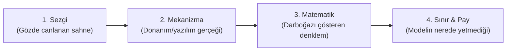

# Makale Şablonu, Pedagojik Akış ve Yazım Standartları

Bu rehber; blogun mimari yazım standardını, **kolektif yol arkadaşı üslubunu**, **dört basamaklı zihinsel model metodolojisini**, **üçlü sayısal hakikat disiplinini**, KaTeX formül kurallarını, adım adım sayısal hesap yürüyüşlerini, pedagojik durakları ve Türkçe üslup ilkelerini tanımlar.

---

## 1. Makale Anatomisi ve Canlı Açılış Kurgusu

Her makale dosyasında (`en/blog/posts/<slug>.md` ve `tr/blog/posts/<slug>.md`) aşağıdaki yapı istisnasız korunur:

```markdown
[Başlıksız 3–4 paragraflık Canlı Zihinsel Giriş]
- Gözde canlanan somut mühendislik sahnesi ("Bir veri merkezine girdiğinizi hayal edin...")
- Ölçülebilir mühendislik gerilimi veya paradoks (1.024 H100, MFU = %38: "Peki kalan %62 nerede?")
- Temel Fikir / Pusula Cümlesi ("Bu yazının temel fikri şu: ...")
- Okuma Pusulası ("Nasıl okuyabilirsiniz?", "Birlikte izleyeceğimiz öğrenme yolculuğu")
- Sayısal doğruluk ve bağlam notu

**In this article** veya **Bu yazıda**
- [1. Bölüm Adı](#1-bolum-adi)
- ...
- [Okuyucu artık hangi sorulara kendi başına yanıt verebilir?](#okuyucu-artık-hangi-sorulara-kendi-başına-yanıt-verebilir)
- [Bütün hikâye altı satırda](#bütün-hikâye-altı-satırda)
- [Terimler sözlüğü](#terimler-sözlüğü)
- [Kaynaklar ve doğrulama bağlantıları](#kaynaklar-ve-doğrulama-bağlantıları)

---

## 1. Bölüm Adı
[1. Sezgi: Tanıdık olay / günlük hayat benzetmesi]
[2. Mekanizma: Donanımda ve yazılımda gerçekte hangi aktörler çalışıyor?]
[3. Matematik: Darboğazı görünür kılan yalın denklem + Sembol okuması]
[4. Sınır & Gerçeklik Payı: Denklemin / benzetmenin sınırları ve istisnaları]
[Pedagojik Durak: Öğrenme Kontrolü veya Düşünce Deneyi]

---

## ... (Bölümler ve Çizimler: Yalnızca Inline SVG)

---

### Ara Durak: Kavram Karışıklıklarını Çözme
[Bandwidth vs Latency / Concurrency vs Parallelism / Occupancy vs MFU]

---

## ... Üç Mühendislik Gözü: Training vs Prefill vs Decode

---

## N. PyTorch ile Adım Adım Tam Doğrulama
[Çalıştırılabilir Python / PyTorch Kodu]
[Konsol Çıktısı]

---

### Okuyucu artık hangi sorulara kendi başına yanıt verebilir?
[Zihinsel model soruları: "Bir byte nereden geliyor? Kim kimi bekliyor? Hangi darboğaz yaşanıyor?"]

---

## Bütün hikâye altı satırda
- 1. Madde
- 2. Madde
- 3. Madde
- 4. Madde
- 5. Madde
- 6. Madde

---

## Terimler sözlüğü
- **Terim (İngilizce)** — tanım + sezgi ya da somut mühendislik faturası.

---

## Kaynaklar ve doğrulama bağlantıları
- **[K1]** Birincil kaynak / orijinal makale
- **[K2]** Resmi dokümantasyon / `config.json`
- **[Kn]** Blog içi çapraz bağlantılar: [Makale Adı](post.html?slug=...)
```

---

## 2. Pedagojik İlerleme: Dört Basamaklı Zihinsel Model

Teknik bir kavram aktarılırken kuru formüller veya havada kalan masallar yerine dört basamaklı merdiven izlenir:



### 1. Sezgi (Grounded Intuition & Familiar Scene)
- Problemi fiziksel dünyadan tanıdık bir sahneyle hissettirin (ör. restoran zinciri, hat aşçısı, mutfak tezgâhı, kiler, koridor, lojistik yolları; kamyonun taşıma kapasitesi vs yolun uzunluğu).
- **Metafor Disiplini:** Seçilen analoji baştan sona tutarlı geliştirilmelidir (tek aşçı $\to$ 132 aşçılı mutfak $\to$ 8 mutfaklı restoran $\to$ restoran zinciri).
- Analoji asla soyut bir masal olarak bırakılamaz; hemen ardından teknik gerçekle birebir eşleştirilir.

### 2. Mekanizma (Physical Hardware & Software Reality)
- Donanımda ve yazılımda gerçekte hangi bileşenlerin çalıştığını net terimlerle eşleyin:
  - *Mutfak tezgâhı* = Register ve Shared Memory (SRAM)
  - *Hat aşçısı* = Streaming Multiprocessor (SM) ve Warp Scheduler
  - *Seri üretim makinesi* = Tensor Core
  - *Restoran kileri* = HBM (High Bandwidth Memory)
  - *İç servis koridoru* = NVLink ve NVSwitch Crossbar
  - *Şehirlerarası lojistik* = InfiniBand / RoCE v2 Rail-Optimized Fat-Tree
  - *Merkez ambar* = Dağıtık GPUDirect Depolama
- Donanım ve matematik seviyesinde fiziksel olarak neyin tıkandığını gösterin (HBM transfer darboğazı, karesel matris tahsisatı patlaması, tail latency, warp divergence).

### 3. Matematik ve Sayısal Yürüyüş (Bottleneck Equations)
- Darboğazı görünür kılan yalın denklemler kurun (Roofline $\alpha = \frac{\text{FLOP}}{\text{Byte}}$, Little's Law $L = \lambda W$, GEMM/GEMV veri-hareket denklemi, Young-Daly arıza optimizasyonu $\tau = \sqrt{2\,\delta\,M}$).
- **Sembol Okuması Zorunludur:** Formülün hemen altına *"Şöyle okuyun:"* denilerek sembol sembol ne anlama geldiği açıklanır. Sembol açıklaması olmayan formül süsten ibarettir.
- **Adım Adım Küçük Sayısal Yürüyüş:**
  - Boyut küçük tutulur ($d=4$, $2 \times 2$ veya 3 kelime).
  - Ara adımlar asla atlanmaz (`\sqrt{4} = 2 \to 6 / 2 = 3` tek tek gösterilir).
  - Sayılar hizalı bir ````text``` bloğunda verilir.
  - Sayıların kaynağı söylenir: *"öğrenilmiş ağırlık"*, *"hesaplanmış koordinat"* veya *"girdi tensörü"*.

### 4. Sınır & Gerçeklik Payı (Boundary / Reality Caveat)
- Denklemin, öğretici varsayımın ve benzetmenin nerede yetersiz kaldığı, donanım nesline, compiler optimizasyonuna veya iş yüküne göre nerede değiştiği açıkça konuşulur (*"Bu sayı bir doğa kanunu değildir; belirli bir veri tipi ve donanım kesişimidir"*).
- Her mimari kararın bir ödünleşim (trade-off) getirdiği hatırlatılır.

---

## 3. Sistemin Temel Omurgası: "Bir Byte'ın Yolculuğu" ve İki Kurucu İlke

Büyük sistemleri anlatırken kopuk terimler listelemek yerine daima şu soruya dönülür:
> **"Bir byte veri nereden geliyor, hangi işlemi mümkün kılıyor, sonra nereye gidiyor ve o yolculukta kim kimi bekliyor?"**

Bu soru iki evrensel sistem tasarımı ilkesi üzerinden çözülür:
1. **Veriyi Mümkün Olduğunca Yakın Tutmak (Data Locality):**
   - Register $\to$ Shared Memory/SRAM $\to$ L2 $\to$ HBM $\to$ NVLink alanı $\to$ Düğümler arası ağ $\to$ Depolama.
   - Tiling, kernel fusion, FlashAttention ve düğüm içi tensör paralelliği hep bu ilkenin tezahürüdür.
2. **Kaçınılmaz Beklemeyi Başka Faydalı İşle Doldurmak (Latency Hiding & Overlap):**
   - Fiziksel gecikme sihirle sıfırlanmaz; başka işle örtülür.
   - SM düzeyinde warp switching, donanımda TMA asenkron kopyaları, dağıtık eğitimde 1F1B pipeline zamanlaması, backward hesaplama ile AllReduce iletişiminin örtüştürülmesi, depolamada asenkron checkpointing hep bu ilkeyle çalışır.

---

## 4. Sayısal Disiplin: Üçlü Hakikat Ayrımı

Makalelerdeki tüm sayılar üç kategoriye ayrılır ve asla birbirine karıştırılmaz:
1. **Üretici Teknik Özellikleri / Tepe Değerler (Vendor Peak Specs):**
   - H100 SXM5 990 TFLOP/s BF16 non-sparse, 3,35 TB/s HBM3, 900 GB/s NVLink çift yönlü.
   - Daima "teorik tepe değeri" veya "katalog tavanı" olarak nitelenir.
2. **Bağımsız / Sahada Raporlanmış Gerçek Ölçümler (Empirical Benchmarks):**
   - LLaMA 3 405B %38–41 MFU, MegaScale 12.288 GPU'da %55,2 MFU, Lambda Blackwell MFU ölçümleri.
   - Gerçek dünya verisi, arıza oranları ve ölçülmüş throughput değerleri.
3. **Varsayım İçeren Öğretici Modeller (Pedagogical Toy Models):**
   - $B=1..512$ için idealize edilmiş matris veri hareketi tablosu, $d=4$ oyuncak tensör yürüyüşü.
   - "Bu sayılar gerçek ölçülmüş kernel FLOP/s değerleri değil, sistemin davranışını zihinde canlandırabilmek için kurulmuş öğretici bir modeldir" notu mutlaka düşülür.

---

## 5. Pedagojik Duraklar: Öğrenme Kontrolü, Düşünce Deneyi ve Ara Durak

Okurun metin boyunca aktif bir katılımcı kalması için şu üç pedagojik durak kullanılır:

- **Öğrenme Kontrolü (Learning Check):**
  Okurun ezber yapmasını ve yaygın yanılgılara düşmesini engelleyen refleks uyarıları:
  > **Öğrenme kontrolü:** Bir kernel'i hızlandırmak için 'daha çok thread' açmak isteyebilirsiniz. Önce register spill, shared memory kullanımı ve occupancy dengesini ölçmeden bunu yapmak performansı kötüleştirebilir.
- **Düşünce Deneyi (Thought Experiment):**
  Okuru aktif akıl yürütmeye sevk eden varsayımsal senaryolar:
  > **Düşünce deneyi:** Bir kernel 256 thread'lik bloklarla çalışırken aynı SM'de yalnızca bir blok yerleşebiliyorsa, blok büyüklüğünü 128'e indirmek neden bazen daha fazla aktif warp sağlayabilir?
- **Ara Durak (Concept Untangling):**
  Birbirine karışan teknik kavramları netleştiren mola bölümleri:
  - *Bandwidth vs Latency:* Otoyolun şerit sayısı (kapasite) vs yolun kilometre uzunluğu (bekleme süresi).
  - *Concurrency vs Parallel Execution vs Latency Hiding:* Aşçıların ocaktayken sebze doğraması vs 8 aşçının aynı anda tabak pişirmesi vs fırını beklerken diğer siparişe geçmesi.
  - *Occupancy vs Tensor Core Doluluğu vs MFU:* SM'in aktif görünmesi ile Tensor Core'ların faydalı FLOP üretmesi arasındaki fark.
  - *Strong Scaling vs Weak Scaling:* Sabit işi daha çok GPU'ya bölmek vs GPU sayısıyla birlikte işi de büyütmek.

---

## 6. Üç Mühendislik Gözü: Training vs Prefill vs Decode (Pazarlıksız)

Her teknik makale konusunu üç ayrı çalışma rejiminde ele alır:

| Boyut | Eğitim (Training) | Ön-Doldurma / Çıkarım (Prefill) | Kod Çözme / Çıkarım (Decode) |
| :--- | :--- | :--- | :--- |
| **İş Yükü Biçimi** | Büyük batch, GEMM yoğunluklu | Uzun prompt sekansı, GEMM | Teker teker token üretimi, GEMV |
| **Donanım Rejimi** | Compute-bound (Tensor Core) | Compute-bound (Parallel GEMM) | Memory-bandwidth-bound (<1 FLOP/bayt) |
| **Bellek Faturası** | Ağırlık + Gradyan + Optimizer (AdamW 16B/param) | Model Ağırlıkları (FP16/FP8) | Model Ağırlıkları + Büyüyen KV Cache |
| **Kritik Metrik** | MFU, TFLOP/s/GPU, loss kararlılığı | İlk Token Gecikmesi (TTFT) | Token Başına Gecikme (TPOT), Throughput |
| **Temel Darboğaz** | AllReduce ağ senkronizasyonu, checkpoint G/Ç | HBM aktarım süresi, dikkat matrisi | HBM bellek bant genişliği darboğazı |

---

## 7. Türkçe Dil Standartları, Üslup ve Çift Dilli Simetri

- **Kolektif Yol Arkadaşı Tonu (Collaborative Mentorship):**
  - Anlatıcı tepeden bakan bir otorite değil; okurla aynı masada beyaz tahta başına geçmiş kıdemli bir sistem mühendisidir.
  - 1. çoğul şahıs ve davetkâr geçişler kullanılır: *"birlikte anlamaya çalışalım"*, *"Önce hesaplamanın en küçük birimini... anlamaya çalışacağız"*, *"Şimdi ilginç bir soruya geldik"*, *"Biraz düşünün"*, *"Peki bu 32 kişilik ekipler nerede çalışıyor?"*, *"Mantıklı görünüyor, değil mi? Fakat her warp'ın bir maliyeti var."*
- **Mühendislik Alçakgönüllülüğü:**
  - *"Sihirli reçete veya gümüş kurşun yoktur."*
  - Her optimizasyon bir ödünleşim (trade-off) getirir ve bu açıkça tartışılır.
- **TR Bağımsız Okunur:** TR sürüm asla yapay zeka çevirisi gibi kokmamalıdır; Türkçe teknik makale yazan deneyimli bir mühendisin elinden çıkmış gibi akıcı, berrak ve doğal olmalıdır.
- **Teknik Terim Kuralı:** Metot ve mimari adları İngilizce kalır; İLK geçişte parantez içinde yerleşik Türkçe karşılığı verilir:
  - *self-attention (öz-dikkat)*, *context vector (bağlam vektörü)*, *tied embeddings (bağlı embedding katmanları)*, *latency hiding (gecikme gizleme)*, *memory coalescing (bellek birleştirme)*.
- **Rakam Formatı:** Türkçe metinlerde ondalık ayracı **virgül** (`%38`, `3,35 TB/s`), binlik ayracı **nokta** (`1.024`, `16.384`) kullanılır.
- **Telgraf Cümlesi Yasağı:** Düzyazıda parçalı veya telgraf cümleler kurulmaz. Tam, dengeli ve ritmik cümleler şarttır.

---

## 8. posts.json ve 5N1K Kuralı

`posts.json` içindeki `summary` alanı `<meta name="description">` olarak da kullanıldığı için markdown (`**bold**` vb.) içermez; düz metin olarak 5N1K yapısıyla yazılır:

- **Ne:** Konunun tek cümlelik teknik tanımı.
- **Neden önemli:** Ölçülebilir mühendislik gerilimi (VRAM, FLOP, gecikme, maliyet).
- **Nasıl:** Makalede adım adım incelenen mekanizmalar ve çözümler.
- **Nerede:** Vaka çalışması olarak seçilen somut model/sistem (örn. Gemma 3, LLaMA 3.1, vLLM).
- **Kim için:** Hedef kitle mühendis profili.
- **Ne zaman:** Hangi mimari karar veya üretim arızası eşiğinde okunmalı.
